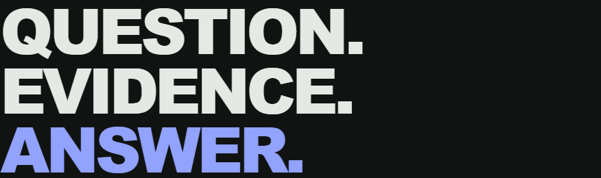
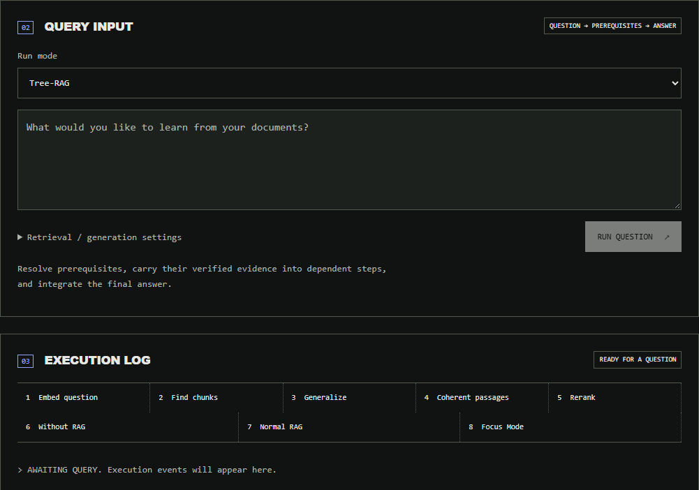

# retrieval-demo

Compare four ways to answer questions from PDFs, locally with Qwen. Inspect the evidence, prompts, and execution behind each answer.



## Quick start

Requires Docker Compose and an NVIDIA GPU supported by Docker. On Windows, use Docker Desktop with Linux containers and WSL 2.

```sh
docker compose up --build
```

Open **http://localhost:8000**, upload a text-based PDF, choose a mode, and ask a question.

The first launch downloads several gigabytes of model weights. The reranker runs on CPU and loads on demand. Models and saved runs persist between restarts.

## Four approaches

| Approach | How it works |
| --- | --- |
| **Without RAG** | Answers from model knowledge, without PDF evidence. |
| **Normal RAG** | Retrieves similar PDF chunks and supplies them to Qwen. |
| **Focus Mode** | Broadens the search, builds coherent passages, and reranks them against your question. |
| **Tree-RAG** | Resolves dependent subquestions using Focus retrieval, then combines the evidence. |

Compare Without RAG, Normal RAG, and Focus side by side, or run Normal, Focus, and Tree independently.



Inspect source passages, scores, exact prompts, and execution traces. Save comparison ratings, reopen history, or export runs as JSON. Light and dark themes are included.

## Configuration

Copy [`.env.example`](.env.example) to `.env` to customize models and reasoning limits.

Defaults: **Qwen3 8B** for generation, **Qwen3 Embedding 0.6B** for embeddings, **Qdrant** for vector search, and **BGE reranker v2 m3** for reranking. No model training is required.

```sh
# Stop without removing saved data
docker compose down

# View service logs
docker compose logs -f
```

See the [technical guide](docs/technical-guide.md) for architecture, retrieval details, API usage, and local development. Interactive API documentation is available at **http://localhost:8000/docs**.

## Limitations

- Intended for local, single-user use; authentication is not included.
- Text-based PDFs only; OCR is not included. Maximum upload size: 25 MB.
- Answers and citations need verification. More complex retrieval does not guarantee better answers.
- `docker compose down --volumes` deletes saved data and downloaded container models.
